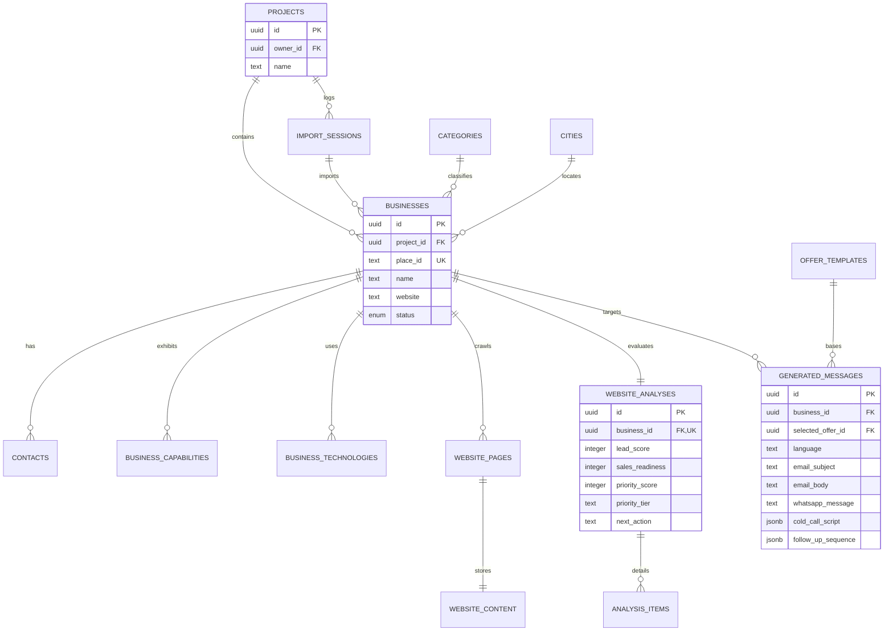

# AI Lead Intelligence Platform (LeadForge) — Comprehensive Architectural & Technical Audit Report

---

## 1. Executive Summary

### System Overview
**LeadForge** is an enterprise-grade, AI-powered Business Lead Generation, Enrichment, Analysis, and Sales Intelligence Platform. Built on React 19, TypeScript, TailwindCSS, Deno-powered Supabase Edge Functions, and Google Gemini AI models, the system transforms raw local search listings into actionable, multi-channel B2B sales opportunities.

### Problem Solved
Traditional B2B lead generation relies on generic web scrapers that produce bulk lists of raw contacts (phone numbers and emails) without context. Sales teams waste hundreds of hours manually reviewing websites, identifying tech stacks, determining pain points, drafting personalized emails, and deciding who to call first. LeadForge automates this entire pipeline—from discovery to cold-outreach script generation—in seconds.

### Target Users
- **B2B Sales Agencies & Outbound Teams**: Seeking pre-qualified leads with ready-to-use outreach copy.
- **AI Automation & IT Agencies**: Looking for local businesses (clinics, salons, restaurants, law firms) missing modern features like chatbots, online booking, or WhatsApp automation.
- **SaaS Founders & Freelancers**: Needing focused outbound pipeline management with automated lead scoring.

### Business Value
LeadForge converts raw directory search results into high-converting sales pipelines. By combining **algorithmic reachability scoring** with **Gemini AI strategic analysis**, it eliminates manual research, reduces customer acquisition cost (CAC), increases cold outreach conversion rates, and surfaces high-value automation opportunities.

### Differentiator from Normal Lead Scraping Tools
Unlike traditional scrapers (e.g., PhantomBuster, Outscraper, Apollo) that merely dump basic metadata:
1. **Intelligent Reachability & Priority Scoring**: Combines Gemini's AI Lead Score (0–100) with a deterministic contact reachability formula (Sales Readiness 0–100) to output a unified **Priority Score** and Tier (`IMMEDIATE`, `HIGH`, `MEDIUM`, `LOW`).
2. **Deep Native Web Scraper & Extraction**: Crawls key site pages (`/`, `/about`, `/contact`, `/services`, `/booking`) to automatically detect social handles, contact verification status, tech stack signatures (WordPress, React, Shopify, Analytics), and business capabilities (WhatsApp widgets, booking engines, online payment forms).
3. **Structured Gemini AI Strategic Audit**: Runs structured JSON schema AI analysis (`gemini-2.5-pro`) to extract strengths, weaknesses, automation opportunities, AI opportunities, sales hooks, and recommended offers.
4. **Automated Multi-Channel Sales Asset Generator**: Uses `gemini-3.5-flash` to select pre-configured offer templates and generate tailored cold emails, WhatsApp messages, 30-second cold call scripts with objection handling, and 3-step follow-up sequences in multiple languages (English, Arabic, French).

---

## 2. Current Capabilities

### A) Data Collection Capabilities

#### Sources & Integration
- **Primary Source**: Google Places API (`https://places.googleapis.com/v1/places:searchText`).
- **Secondary Provider Enums (Schema-ready)**: `YELP`, `BING_MAPS`, `CSV_IMPORT`, `MANUAL`.

#### Search & Import Methods
- User specifies `keyword` (e.g. "Dental Clinic"), `city` (e.g. "Riyadh"), `country` (e.g. "Saudi Arabia"), and `max_results`.
- Search query formatted as: `"[keyword] in [city] in [country]"`.
- **Cost-Optimized FieldMask**: Only requests necessary fields to minimize Google Places API billable units:
  ```text
  places.id, places.displayName, places.types, places.formattedAddress, 
  places.location, places.rating, places.userRatingCount, places.websiteUri, 
  places.nationalPhoneNumber, places.internationalPhoneNumber, nextPageToken
  ```
- **Automatic Deduplication**: Implemented via `Deduplicator` service checking `place_id` uniqueness per project prior to insertion.

#### Data Fields Collected
- `place_id` (Google Unique ID)
- `name` (Business Display Name)
- `address` (Formatted Address)
- `latitude` & `longitude`
- `rating` (0.0 to 5.0) & `reviews` count
- `website` (URI)
- Phone numbers (`nationalPhoneNumber`, `internationalPhoneNumber`)
- Primary Category (auto-upserted to `categories` table)
- City & Country (auto-upserted to `cities` table)

#### Accuracy & Limitations
- **Accuracy**: Extremely high for official Google Places metadata (verified geolocation, ratings, official phone & website).
- **Limitations**:
  - Max 60 results (3 pages of 20 results) per import job execution.
  - Requires valid Google Places API Key.
  - Rate limited by user quota (default: 100 imports per user per day via `increment_usage` RPC).

---

### B) Data Enrichment Capabilities

Enrichment is executed via the `enrich-business` Edge Function using `NativeScraper` and HTML Regex parsing.

#### Website Discovery & Crawling
- Crawls up to 5 sub-paths on target domain: `/`, `/about`, `/contact`, `/services`, `/booking`.
- Applies custom Browser User-Agent header and 10-second request timeout per page.

#### Contact Extraction
- **Email Regex Parsing**: Extracts emails from raw page text and mailto links. Filters out standard false positives (e.g., `.png`, `.jpg`, `.js` references).
- **Phone & WhatsApp Detection**: Extracts telephone URIs (`tel:`, `whatsapp:`) and phone number regex pattern matches.
- **Verification & Confidence**: Assigns source tag (`WEBSITE_SCRAPER`) and initial confidence level (100%).

#### Social Links Extraction
- Parses anchor hrefs for platform-specific URLs:
  - **Facebook**: `facebook.com/...`
  - **Instagram**: `instagram.com/...`
  - **LinkedIn**: `linkedin.com/...`
  - **WhatsApp**: `wa.me/...` or `api.whatsapp.com/...`

#### Technology Stack Detection
Scans DOM content and script tags for signature signatures:
- **CMS / Frameworks**: WordPress, Shopify, Wix, Squarespace, Webflow, React, Next.js, Vue.js, Angular, Laravel.
- **Analytics**: Google Analytics, Google Tag Manager, Meta Pixel.

#### Business Information & Capability Extraction
Analyzes HTML elements to detect functional flags saved in `business_capabilities`:
- `whatsapp`: WhatsApp chat button/link present.
- `facebook` / `instagram`: Social profile presence.
- `booking`: Presence of booking widgets (Calendly, Acuity, custom form).
- `chat_widget`: Live chat software detected (Tidio, Intercom, Crisp, Drift).
- `online_payment`: E-commerce / gateway signatures (Stripe, PayPal, Checkout).

---

### C) AI Analysis Capabilities

AI Analysis is executed by `analyze-business` Edge Function using Google Gemini (`gemini-2.5-pro`).

#### Processing Flow
```
1. Fetch Business + Contacts + Capabilities + Tech Stack + Website Content
   ↓
2. DataPackBuilder constructs unified JSON Data Package
   ↓
3. Rate Limiter check (User daily Gemini call quota)
   ↓
4. Gemini API request with strict JSON Schema (gemini-2.5-pro, temp 0.2, 30s timeout)
   ↓
5. AiValidator verifies response fields and types
   ↓
6. PriorityCalculator computes sales_readiness, priority_score, priority_tier, next_action
   ↓
7. Persist to website_analyses, analysis_items, api_usage
```

#### Input Data (`DataPackBuilder`)
Includes business metadata, Google rating/reviews, detected contacts, capabilities, tech stack list, and scraped text snippets (truncated to 3,000 characters across pages to prevent token bloat).

#### Output Structure & Schema Enforcement
Enforced via Gemini API `responseSchema`:
- `business_summary` (string)
- `strengths` (string array)
- `weaknesses` (string array)
- `automation_opportunities` (string array)
- `ai_opportunities` (string array)
- `sales_angle` (string)
- `recommended_offer` (string)
- `lead_score` (integer 0–100)
- `score_explanation` (string)
- `confidence_score` (`HIGH` | `MEDIUM` | `LOW`)

#### Insight Generation Breakdown
- **Weaknesses**: Identifies missing capabilities (e.g., "No online booking", "Missing live chat widget", "No WhatsApp integration").
- **Opportunities**: Pinpoints standard software automation vs. generative AI transformation (e.g., 24/7 AI Receptionist, Automated WhatsApp Reminders).
- **Lead Scoring**: Assigns an integer from 0 to 100 indicating how desperate or ready the business is to purchase automation solutions.

---

### D) Sales Intelligence Capabilities

Sales Generation is executed by `generate-sales` Edge Function using `gemini-3.5-flash`.

#### Conversion Architecture
1. **Offer Matching (`OfferMatcher`)**: Pre-filters database offer templates (`offer_templates` table) by matching target industries and detected weakness tags.
2. **AI Selection & Sales Generation (`gemini-3.5-flash`)**: Accepts analysis output + top 3 offer candidates + target language (`en`, `ar`, `fr`).

#### Scoring & Prioritization Logic
- **Sales Readiness (0–100)**: Evaluates contact reachability:
  $$\text{Score} = \text{Email (25)} + \text{Phone (20)} + \text{WhatsApp (20)} + \text{LinkedIn (10)} + \text{Website (15)} + \text{Address (10)}$$
- **Priority Score (0–100)**: Unified composite score:
  $$\text{PriorityScore} = 0.55 \times \text{LeadScore} + 0.45 \times \text{SalesReadiness}$$
- **Priority Tier**:
  - `IMMEDIATE`: Score $\ge 90$
  - `HIGH`: Score $70 - 89$
  - `MEDIUM`: Score $50 - 69$
  - `LOW`: Score $< 50$
- **Recommended Action (`next_action`)**: Deterministic selection based on contact details:
  - Phone available + Lead Score $\ge 70 \rightarrow$ `CALL`
  - Professional email domain $\rightarrow$ `EMAIL`
  - WhatsApp handle $\rightarrow$ `WHATSAPP`
  - Fallback email $\rightarrow$ `EMAIL`
  - No contact details $\rightarrow$ `IGNORE`

#### Generated Outreach Deliverables
- **Cold Email**: Tailored subject line (<60 chars) + 3–4 paragraph value pitch with CTA.
- **WhatsApp Message**: Short, personal, 2–3 paragraph conversational hook.
- **Cold Call Script**:
  - **Hook**: 10-second opening referencing business specifics.
  - **Pitch**: 30-second main value proposition.
  - **Objection Handling**: Tactical responses for top 3 objections (price, timing, status quo).
- **Follow-up Sequence**: 3 structured steps (Day 1 initial follow-up, Day 3–4 value reminder, Day 7–8 final close attempt) with specific channel and message text.

---

## 3. Data Architecture

### Data Flow Diagram

```
[ User Search Input ] (Keyword, City, Country)
        │
        ▼
[ import-businesses Edge Function ] ──(Rate Limit & Ownership Check)
        │
        ├──────────────────────────────► [ Google Places API ]
        │                                        │
        ▼                                        ▼
[ BusinessImporter & Deduplicator ] ◄── (Raw Places JSON)
        │
        ▼
[ Supabase DB: businesses, contacts, import_sessions, categories, cities ]
        │
        ▼
[ enrich-business Edge Function ] ──(NativeScraper Fetch: 5 Sub-pages)
        │
        ├──────────────────────────────► [ Target Business Website ]
        │                                        │
        ▼                                        ▼
[ HtmlParser (Regex) ] ◄────────────────── (Raw HTML Response)
        │
        ▼
[ Supabase DB: website_pages, website_content, business_capabilities, business_technologies, contacts ]
        │
        ▼
[ analyze-business Edge Function ]
        │
        ├──► [ DataPackBuilder ] ──(Aggregates Business + Scraped Data)
        │           │
        │           ▼
        ├──► [ Gemini API: gemini-2.5-pro ] ──(consultant-v1 Prompt)
        │           │
        │           ▼
        └──► [ PriorityCalculator ] ──(Computes Composite Scores & Tiers)
                    │
                    ▼
[ Supabase DB: website_analyses, analysis_items, api_usage ]
        │
        ▼
[ generate-sales Edge Function ]
        │
        ├──► [ OfferMatcher ] ──(Queries offer_templates Table)
        │           │
        │           ▼
        └──► [ Gemini API: gemini-3.5-flash ] ──(sales-generator-v1 Prompt)
                    │
                    ▼
[ Supabase DB: generated_messages (per language en/ar/fr) ]
        │
        ▼
[ React 19 Frontend Dashboard ] (Pipeline Kanban Board / Business Table / Messages Hub)
```

### Detailed Step Explanation
1. **Search Request**: User submits search params in the UI. The request hits `import-businesses` with JWT token.
2. **Quota & Verification**: Edge Function verifies project ownership via RLS helper and calls `increment_usage` RPC for rate limiting.
3. **Places Fetching & Mapping**: `GooglePlacesService` requests places via REST API, maps raw response into domain models, deduplicates against `place_id`, and writes to `businesses`, `contacts`, `cities`, `categories`, and `import_sessions`.
4. **Enrichment Crawl**: Triggered per business. `NativeScraper` fetches `/`, `/about`, `/contact`, `/services`, `/booking`. `HtmlParser` extracts tech stacks, social profiles, emails, phones, and saves records to `website_pages`, `business_capabilities`, and `business_technologies`.
5. **Data Assembly & AI Audit**: `DataPackBuilder` compiles all collected facts into a clean JSON payload. `GeminiService` passes this to `gemini-2.5-pro`. Upon return, `PriorityCalculator` calculates reachability and composite priority scores.
6. **Sales Asset Generation**: User clicks "Generate Sales Assets" or triggers pipeline step. `OfferMatcher` filters compatible templates. `GeminiService` (`gemini-3.5-flash`) generates copy in requested language (`en`, `ar`, `fr`) and persists to `generated_messages`.
7. **UI Presentation**: React Query updates UI state, displaying records on the Pipeline Kanban board grouped by Priority Tier, or in the Messages Hub.

---

## 4. Database Analysis

### Schema Overview (Supabase / PostgreSQL)

| Table Name | Primary Key | Foreign Keys / Key References | Description |
| :--- | :--- | :--- | :--- |
| `projects` | `uuid` | `owner_id -> auth.users(id)` | Top-level workspace container. |
| `categories` | `uuid` | None (`name` UNIQUE) | Standardized business categories (e.g. Clinic, Salon). |
| `cities` | `uuid` | None (`UNIQUE(city, country)`) | Normalized city/country pairs. |
| `import_sessions` | `uuid` | `project_id -> projects(id)` | Tracks import jobs, provider, status, total found/imported. |
| `businesses` | `uuid` | `project_id`, `import_session_id`, `category_id`, `city_id` | Core lead record (`place_id` UNIQUE). |
| `contacts` | `uuid` | `business_id -> businesses(id)` | Extracted contact channels (`type`, `value`, `confidence`). |
| `business_capabilities`| `uuid` | `business_id -> businesses(id)` | Feature flags (`whatsapp`, `booking`, `chat_widget`, etc.). |
| `business_technologies`| `uuid` | `business_id -> businesses(id)` | Detected software (`WordPress`, `React`, `Google Analytics`).|
| `website_pages` | `uuid` | `business_id -> businesses(id)` | Scraped page metadata (`url`, `page_type`, `status_code`). |
| `website_content` | `uuid` | `page_id -> website_pages(id)` | Raw scraped HTML text content. |
| `website_analyses` | `uuid` | `business_id -> businesses(id)` (UNIQUE) | AI analysis output (`lead_score`, `priority_score`, `tier`). |
| `analysis_items` | `uuid` | `analysis_id -> website_analyses(id)`| Categorized bullet items (`STRENGTH`, `WEAKNESS`, etc.). |
| `offer_templates` | `uuid` | None (`slug` UNIQUE) | Pre-configured service pitches & hooks. |
| `generated_messages` | `uuid` | `business_id`, `selected_offer_id` | Multi-channel outreach copy (`UNIQUE(business_id, language)`).|
| `user_usage` | `user_id` | `user_id -> auth.users(id)` | Daily quota counter (`imports_today`, `gemini_calls_today`).|
| `api_usage` | `uuid` | `business_id`, `project_id`, `analysis_id` | Granular API cost and token tracking log. |
| `provider_health` | `uuid` | None (`provider` UNIQUE) | Latency and error rate tracking for external APIs. |
| `job_queue` | `uuid` | None | Background job queue table (schema ready). |
| `logs` | `uuid` | `business_id -> businesses(id)` | System operational execution logs. |

### Indexes & Performance Constraints
- **Indexed Fields**: `businesses(project_id, category_id, city_id, status, health_score)`, `website_analyses(lead_score, priority_score, priority_tier)`, `analysis_items(type, analysis_id)`, `contacts(business_id, type)`, `generated_messages(content_hash)`.
- **Security & RLS**: All user-facing tables enforce strict Row Level Security (RLS) checked against `projects.owner_id = auth.uid()`. System tables (`api_usage`, `provider_health`, `job_queue`, `user_usage`) are default-denied to public and accessible via Service Role / RPC (`increment_usage`).

### Data Lifecycle Classification

```
┌────────────────────────────────────────────────────────────────────────┐
│                        PERMANENT STORAGE                               │
├────────────────────────────────────────────────────────────────────────┤
│ • projects, auth.users                                                 │
│ • categories, cities                                                   │
│ • offer_templates                                                      │
│ • user_usage, api_usage (auditing & billing history)                   │
└────────────────────────────────────────────────────────────────────────┘
                                    │
                                    ▼
┌────────────────────────────────────────────────────────────────────────┐
│                        CACHED DATA (Time-To-Live / Refreshable)         │
├────────────────────────────────────────────────────────────────────────┤
│ • businesses (Metadata updated upon re-import)                         │
│ • contacts, business_capabilities, business_technologies              │
│ • website_pages, website_content (Scraped raw DOM text)                │
└────────────────────────────────────────────────────────────────────────┘
                                    │
                                    ▼
┌────────────────────────────────────────────────────────────────────────┐
│                        REGENERATED / DERIVED DATA                      │
├────────────────────────────────────────────────────────────────────────┤
│ • website_analyses & analysis_items (Re-analyzed when site content changes)│
│ • priority_score, priority_tier, next_action                           │
│ • generated_messages (Regenerated on language change or offer update)  │
└────────────────────────────────────────────────────────────────────────┘
```

---

## 5. Current Data Model



---

## 6. Dashboard Analysis

### User Interface Presentation
The React frontend provides a modern dark-mode aesthetic built with TailwindCSS and Lucide icons. It centers around two workspace views:

```
┌─────────────────────────────────────────────────────────────────────────┐
│                               HEADER BAR                                │
│ Project Selector | Quick Stats | Multi-Language | Search & Import Button│
├─────────────────────────────────────────────────────────────────────────┤
│                          OPERATIONAL METRICS                            │
│ Total Businesses | Analyzed Count | Daily Import Quota | Gemini Quota   │
├─────────────────────────────────────────────────────────────────────────┤
│      VIEW SWITCHER: [ ░░ Pipeline View (Kanban) ] [ ≡ Table View ]      │
├─────────────────────────────────────────────────────────────────────────┤
│                                                                         │
│  PIPELINE VIEW (KANBAN)                                                 │
│  ┌──────────────┐  ┌──────────────┐  ┌──────────────┐  ┌──────────────┐ │
│  │  IMMEDIATE   │  │     HIGH     │  │    MEDIUM    │  │     LOW      │ │
│  │ (Score >=90) │  │(Score 70-89) │  │(Score 50-69) │  │ (Score <50)  │ │
│  ├──────────────┤  ├──────────────┤  ├──────────────┤  ├──────────────┤ │
│  │ Lead Card A  │  │ Lead Card C  │  │ Lead Card E  │  │ Lead Card G  │ │
│  │ Lead Card B  │  │ Lead Card D  │  │ Lead Card F  │  │              │ │
│  └──────────────┘  └──────────────┘  └──────────────┘  └──────────────┘ │
│                                                                         │
└─────────────────────────────────────────────────────────────────────────┘
```

### Key Metrics Displayed
1. **Priority Tier Breakdown**: Instant categorization into `IMMEDIATE`, `HIGH`, `MEDIUM`, `LOW`.
2. **Score Metrics**: Dual visibility into **Lead Score** (AI readiness) and **Sales Readiness** (contactability).
3. **Recommended Next Action Badge**: Highlights `CALL`, `EMAIL`, `WHATSAPP`, or `IGNORE` directly on lead cards.
4. **Operational Quota Counters**: Shows daily import limits and Gemini call counts.

### Workflow & Usability Evaluation
- **Strengths**:
  - Direct 1-click access from lead cards to view full AI Analysis modals (`AnalysisDetailsModal`) and generated sales copy (`SalesAssetsModal`).
  - Ability to filter by language (`en`, `ar`, `fr`) when viewing generated copy.
  - Quick-copy buttons for email subject, email body, and WhatsApp scripts.
- **Workflow Gaps**:
  - Missing direct integration with CRM tools (HubSpot, Salesforce) or email sending providers (SendGrid, Resend).
  - Webhooks/Outreach execution is manual (copying text to clipboard).

---

## 7. Current Strengths

### 1. Robust Technical Architecture
- Modular Deno Edge Function architecture with clear separation of concerns (Repositories, Services, Importers, Resilience Policies).
- Strict Row Level Security (RLS) enforcing data isolation per project owner (`owner_id`).
- Rate limiting and usage accounting built at both user level (`user_usage`) and API cost tracking level (`api_usage`).

### 2. High-Precision AI System Design
- Uses Gemini API structured outputs (`responseSchema`) with low temperature (0.2) to eliminate hallucinations.
- Validates all AI outputs against strict TypeScript types before database entry.

### 3. Pragmatic Hybrid Lead Scoring
- Eliminates reliance on pure AI opinion by combining Gemini AI's qualitative rating with deterministic contact reachability scoring (`PriorityCalculator`).

### 4. Multi-Channel & Multi-Lingual Sales Intelligence
- Automatically generates complete outreach collateral (Cold Email, WhatsApp, Cold Call Script with Objection Handling, 3-step Follow-up) tailored in English, Arabic, or French.

---

## 8. Current Weaknesses & Operational Risks

### 1. Native HTTP Scraper Limitations (Critical Scraping Gap)
- The current `NativeScraper` uses standard HTTP `fetch()` with regex parsers.
- **Client-Side Rendered (SPA) Impact**: Single Page Applications built with React, Vue, or Angular that render content dynamically via JavaScript return blank or minimal HTML skeletons, resulting in missed contact info and inaccurate tech stack detection.

### 2. Synchronous Execution Flow (Timeout Risk)
- Scraping and AI analysis are executed **synchronously** inside the Edge Function request handler.
- If target business websites respond slowly, the Edge Function risks hitting Deno HTTP request timeout limits.
- *Mitigation Path*: Move execution to the existing `job_queue` table using async background workers.

### 3. Hardcoded Sub-Page Paths
- Crawler only checks fixed sub-paths (`/`, `/about`, `/contact`, `/services`, `/booking`). Sites using non-standard URLs (e.g., `/contact-us`, `/our-team`, `/get-started`) are missed.

### 4. Lack of Direct Outreach Automation
- Sales assets are generated perfectly, but require manual copying and pasting. No direct integration with SMTP, Resend, WhatsApp Business API, or webhooks.

---

## 9. Current Business Value (Services Packageable for Sale)

LeadForge equips agencies and consultants to pitch high-margin automation solutions to local businesses:

```
┌─────────────────────────────────────────────────────────────────────────┐
│                    HIGH-VALUE AGENCY OFFER PACKAGES                     │
├──────────────────────────┬──────────────────────────────────────────────┤
│ OFFER PACKAGE            │ TARGET BUSINESS DEFICIENCY IDENTIFIED        │
├──────────────────────────┼──────────────────────────────────────────────┤
│ 1. AI Receptionist       │ High call volume, no online booking,         │
│    & Voice Bot           │ voicemail reliance detected during analysis. │
├──────────────────────────┼──────────────────────────────────────────────┤
│ 2. WhatsApp Booking      │ Manual phone booking only; missing digital   │
│    Automation            │ self-service scheduling.                     │
├──────────────────────────┼──────────────────────────────────────────────┤
│ 3. 24/7 AI Customer      │ Absence of live chat widget or instant       │
│    Support Agent         │ FAQ resolution on website.                   │
├──────────────────────────┼──────────────────────────────────────────────┤
│ 4. Modern Website &      │ Missing mobile responsiveness, outdated      │
│    Local SEO Redesign    │ stack, missing schema markup or SSL.         │
└──────────────────────────┴──────────────────────────────────────────────┘
```

---

## 10. Final Assessment

### Current Maturity Level
**Production-Ready Beta / MVP (Phase 6 Complete)**

The core platform architecture, database schema, Deno edge services, Gemini AI integration, scoring pipelines, and React user interface are fully functional and production-ready for early agency deployment.

### System Audit Scorecard

```
┌────────────────────────────────────────────────────────────────────────┐
│                        SYSTEM AUDIT SCORECARD                          │
├─────────────────────────┬──────────┬───────────────────────────────────┤
│ CATEGORY                │ SCORE    │ RATIONALE                         │
├─────────────────────────┼──────────┼───────────────────────────────────┤
│ Architecture & Tech     │  8.5/10  │ Clean Deno edge setup, strict RLS,│
│                         │          │ rate-limiting & cost tracking.    │
├─────────────────────────┼──────────┼───────────────────────────────────┤
│ Data Engine & Scraping  │  7.5/10  │ Fast HTTP scraping & Places API,  │
│                         │          │ but lacks headless browser JS.    │
├─────────────────────────┼──────────┼───────────────────────────────────┤
│ AI & Intelligence       │  8.5/10  │ Enforced JSON schema, grounded    │
│                         │          │ Gemini prompts, hybrid scoring.   │
├─────────────────────────┼──────────┼───────────────────────────────────┤
│ User Experience (UX)    │  8.0/10  │ Modern dark UI, Kanban pipeline,  │
│                         │          │ direct 1-click modals & copy.     │
├─────────────────────────┼──────────┼───────────────────────────────────┤
│ Sales Readiness         │  8.5/10  │ Multi-channel copy (Email, WA,    │
│                         │          │ Call scripts, Follow-ups, Ar/Fr). │
├─────────────────────────┼──────────┼───────────────────────────────────┤
│ OVERALL RATING          │ 8.2 / 10 │ Production-Ready Beta             │
└─────────────────────────┴──────────┴───────────────────────────────────┘
```

### Summary Conclusion
LeadForge is an exceptional, well-engineered AI Lead Intelligence platform. It stands far above typical CRUD or simple API wrapper projects. With the addition of headless browser rendering (for SPA site scraping) and asynchronous job queuing, the system will be ready for high-scale commercial enterprise deployment.
