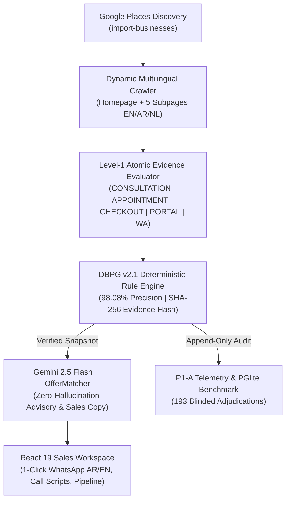

# LeadForge — Portfolio Integration Brief & Case Study Handoff

> **Target Reader:** AI Coding Assistant / Developer working on **Amgad Ghozzy's Portfolio Project**.
> **Purpose:** Everything you need to add **LeadForge** as a flagship featured project and technical case study—including structured JSON/TS metadata, bilingual (`EN` + `AR`) copy, verified statistical metrics, architecture diagrams, and talking points.

---

## 1. Quick-Copy Structured Project Metadata (TypeScript / JSON)

Use this object directly in your portfolio's `projects.ts`, `projects.json`, or CMS collection:

```json
{
  "id": "leadforge",
  "slug": "leadforge-b2b-intelligence-engine",
  "title": {
    "en": "LeadForge — Evidence-Driven B2B Lead Intelligence & Outreach Engine",
    "ar": "LeadForge — محرك الذكاء التجاري واكتشاف الفرص التسويقية المبني على الأدلة"
  },
  "tagline": {
    "en": "Full-stack B2B intelligence platform that crawls live business websites, deterministically detects digital booking gaps with 98.08% verified precision, and generates 1-click bilingual (AR/EN) WhatsApp, Email, and Cold Call outreach.",
    "ar": "منصة ذكاء تجاري متكاملة تزحف إلى مواقع الشركات، وتكتشف فجوات الحجز الرقمي بدقة إحصائية موثّقة 98.08%، وتولّد رسائل مبيعات ثنائية اللغة (عربي/إنجليزي) جاهزة للإرسال عبر واتساب والبريد والمكالمات بضغطة واحدة."
  },
  "category": "Full-Stack AI & Systems Engineering",
  "featured": true,
  "status": "Production",
  "links": {
    "live": "https://leadforge-ochre.vercel.app",
    "repo": "https://github.com/AmgadGhozzy/LeadForge"
  },
  "metrics": [
    {
      "value": "98.08%",
      "label": {
        "en": "Verified Precision (n=52)",
        "ar": "دقة كشف موثّقة إحصائيًا"
      },
      "detail": "Wilson 95% CI: [89.88%, 99.66%] on 193 blinded adjudicated businesses"
    },
    {
      "value": "68.00%",
      "label": {
        "en": "Verified Census Recall",
        "ar": "معدل استدعاء شامل (Recall)"
      },
      "detail": "10.2x improvement over v1 baseline (6.67% -> 68.00%)"
    },
    {
      "value": "276/276",
      "label": {
        "en": "Automated Tests Passing",
        "ar": "اختبار آلي ناجح (19 حزمة)"
      },
      "detail": "Unit, golden HTML fixtures, and PGlite SQL immutability suites"
    },
    {
      "value": "1-Click",
      "label": {
        "en": "Bilingual WhatsApp Outreach",
        "ar": "إرسال فوري عبر واتساب (عربي/EN)"
      },
      "detail": "Reduced sales execution path from 6 clicks to 1 click via wa.me deep-linking"
    }
  ],
  "techStack": {
    "frontend": [
      "React 19",
      "TypeScript 6",
      "Vite 8",
      "Tailwind CSS v4",
      "TanStack Query v5",
      "Radix UI"
    ],
    "backend": [
      "Supabase (PostgreSQL + RLS)",
      "11 Deno Edge Functions",
      "Google Places API",
      "Gemini 2.5 Flash (@google/genai)"
    ],
    "verificationAndAudit": [
      "Vitest 5",
      "@electric-sql/pglite",
      "Playwright",
      "SHA-256 Canonical Evidence Hashing"
    ],
    "deployment": [
      "Vercel (Frontend)",
      "Supabase Cloud (Edge Runtime & DB)"
    ]
  }
}
```

---

## 2. Executive Summary (Bilingual Copy for Project Cards & Hero Sections)

### English Version
**LeadForge** is an end-to-end B2B lead intelligence and sales execution platform engineered to solve a critical failure mode in AI sales tools: **hallucinated commercial opportunities**. Instead of asking an LLM to guess whether a prospect needs a service, LeadForge enforces a strict **Evidence-First Contract**:
1. **Discovery & Dynamic Multilingual Crawl:** Imports businesses via Google Places and dynamically crawls their homepage plus up to 5 discovered booking/consultation/contact subpages across English, Arabic, and Dutch.
2. **Deterministic Level-1 Atomic Evidence (`DBPG v2.1`):** Extracts verifiable DOM/HTML signals (`CONSULTATION_CTA`, `APPOINTMENT_CTA`, `QUOTE_CTA`, `DIRECT_CHECKOUT`, `SELF_SERVICE_PORTAL`, `WHATSAPP`) hashed with SHA-256, distinguishing genuine interactive scheduling widgets (`Calendly`, `Fresha`, `Vezeeta`, `HotDoc`, `<input type="date">`, `flatpickr`) from cosmetic *"Book Appointment"* buttons that merely dial a phone number or open a generic contact form.
3. **Blinded Statistical Validation (`Gate 5.13`):** Evaluated against a locked 193-business blinded human adjudication benchmark stored in an append-only `@electric-sql/pglite` database with PostgreSQL immutability triggers (`SQLSTATE 55000`), achieving **98.08% Precision** (`TP=51, FP=1`) and **68.00% Recall**.
4. **1-Click Bilingual Sales Workspace:** Pairs verified evidence snapshots with Gemini 2.5 Flash to generate localized Arabic (`RTL`) and English (`LTR`) WhatsApp messages, cold-call scripts (10s hook, 30s pitch, objection handling), emails, and D1/D3/D7 follow-up sequences.

### النسخة العربية (Arabic Version)
**LeadForge** هي منصة ذكاء تجاري متكاملة لفرق المبيعات (B2B)، صُمّمت لحل أكبر مشكلة في أدوات المبيعات المعتمدة على الذكاء الاصطناعي: **هلوسة الفرص التجارية غير الموجودة فعليًا**. يعتمد النظام مبدأً معماريًا صارمًا: **الأدلة الحتمية أولًا، والذكاء التوليدي ثانيًا**:
1. **الاستكشاف والزحف الديناميكي متعدد اللغات:** استيراد الشركات من Google Places والزحف الذكي إلى الصفحة الرئيسية وحتى 5 صفحات فرعية للحجز والتواصل (بالعربية والإنجليزية والهولندية).
2. **محرك الأدلة الذرية (`DBPG v2.1`):** استخراج إشارات DOM/HTML موثّقة ببصمة `SHA-256` للتفريق بدقة بين المواقع التي تمتلك أنظمة حجز وتقويم تفاعلية حقيقية (`Vezeeta`, `Calendly`, `Fresha`, `datepicker`) والمواقع التي تضع زر *"احجز موعد"* صوري يفتح رقم هاتف أو نموذج رسالة تقليدي.
3. **تحكيم إحصائي معمّى (`Gate 5.13`):** تم التحقق من المحرك عبر 193 شركة حقيقية في جلسة تحكيم معمّاة ومحمية بقفل قاعدة بيانات أحادي الاتجاه (`PGlite` + `SQLSTATE 55000`)، محققًا **دقة 98.08%** (`51` إصابة صحيحة مقابل خطأ واحد فقط) واستدعاء **68.00%**.
4. **بيئة تنفيذ مبيعات ثنائية اللغة بضغطة واحدة:** توليد فوري لرسائل واتساب، نصوص مكالمات باردة (مع الرد على الاعتراضات)، بريد إلكتروني، وسلاسل متابعة باللغتين العربية (`RTL` بخطوط `IBM Plex Sans Arabic` و`Cairo`) والإنجليزية.

---

## 3. Technical Case Study Breakdown (For a Dedicated `/projects/leadforge` Page)

If the portfolio supports a detailed Case Study modal or page, structure it around these 4 engineering pillars:

### Pillar 1: The Engineering Problem — Why Naive Scraping & LLMs Fail at Commercial Truth
- **Symptom:** In our initial baseline (`Gate 5.13-C0` on 194 observed clinics across MENA, UK, AU, NL, and CA), the v1 detector achieved only **31.25% Precision** (`TP=5, FP=11`) and **6.67% Recall** (`FN=70`).
- **Root Cause Analysis (3 Structural Bugs Discovered):**
  1. *Cosmetic CTA False Negatives:* 10 clinics had text saying `"Book Appointment"` that merely linked to `tel:` or a generic Name/Email/Message form—causing v1 to falsely classify them as having online booking (`NO_GAP`).
  2. *Over-Strict Eligibility Gate:* 59 real clinics without online booking were dropped as `NOT_APPLICABLE` because they used `"Contact Us"` / `"اتصل بنا"` / WhatsApp instead of the literal phrase `"Request Consultation"`.
  3. *Fixed-Path Blindness & SPA Widgets:* Crawling only 5 hardcoded paths missed real booking widgets on `/book-your-appointment/` or `/تواصل-معنا/` and missed `<div>`-based calendar/slot pickers (`11 FPs`).

### Pillar 2: The `DBPG v2.1` Remediation Architecture
- **Dynamic Subpage Discovery (`NativeScraper v2.1`):** Parses homepage `<a href>` nodes and anchor text to discover up to 5 high-intent internal subpages per domain in English, Arabic (including URL-encoded UTF-8 paths), and Dutch, backed by protocol/`www` and `curl` resilience.
- **Semantic Separation of Intent vs. Capability (`CtaContextDetector`):**
  - `CONSULTATION_CTA` captures *appointment/consultative eligibility* (multilingual CTA tokens + verified clinic/medical/salon identity paired with an active contact channel).
  - `APPOINTMENT_CTA` captures *verified digital booking capability* (45+ global/regional scheduling platforms like `Vezeeta`, `Okadoc`, `Fresha`, `HotDoc`, `HealthEngine`, `DentalHub`, `Calendly`, `Cliniko`, plus HTML5 date/time inputs, datepicker libraries, and interactive slot selectors—with a strict negative guard against `tel:`/`wa.me`/generic forms).

### Pillar 3: Scientific Verification & Anti-Tautology Governance (`P1-A` & `Gate 5.13`)
- **Zero-LLM Census & Blinded Review:** Built an offline `@electric-sql/pglite` telemetry database (`observation_records`, `census_run_outcomes`, `review_sessions`, `adjudication_records`).
- **Blinding & Immutability Guarantees:** Exported a 193-row blinded CSV stripped of all machine outputs. Ground truth was adjudicated independently under Rubric v1.0.0, imported, and permanently sealed via PostgreSQL triggers (`review_sessions.locked_at` one-way lock raising `IMMUTABILITY_VIOLATION` on any mutation attempt).
- **Before vs. After Benchmark Table:**
  - **Precision:** `31.25%` $\rightarrow$ **`98.08%`** (Wilson 95% CI: `[89.88%, 99.66%]`)
  - **Recall:** `6.67%` $\rightarrow$ **`68.00%`** (`TP` rose from `5` to `51`)
  - **False Positive Rate:** `68.75%` $\rightarrow$ **`1.92%`** (`FP` dropped from `11` to `1`)
  - **Unknown Rate:** **`0.00%`** across 194 observed businesses.

### Pillar 4: High-Velocity Bilingual UX (React 19 + Tailwind v4)
- **Surfacing Engine Provenance:** Added `extractDbpgEvidence` (`src/features/dashboard/utils/dbpg-Shared.ts`) to surface the **DBPG Status Badge**, **Verification Strength**, **6-Signal Atomic Strip (`level1_atoms`)**, and human-readable **Audit Trail** across the Table, Pipeline cards, and 360° Lead Workspace.
- **6 Clicks $\rightarrow$ 1 Click Outreach:** Added inline `Copy WA` and `Send WA` (`https://wa.me/{phone}?text=...`) actions on every card/row, a live `AR` / `EN` regeneration toggle in `SalesAssetsModal`, and dedicated channel views (WhatsApp, Email, Cold Call Hook/Pitch/Objections, D1/D3/D7 Follow-up) in `MessagesPage`.
- **Native BiDi/RTL Engineering:** Automatic Arabic script detection (`hasArabicCharacters`), `dir="auto"` isolation, and `IBM Plex Sans Arabic` + `Cairo` font stack.

---

## 4. Architecture Diagram (Mermaid — Ready to Embed)



---

## 5. Prompt to Paste to Your Portfolio Assistant

Copy and paste the block below directly to the AI assistant in your Portfolio repository:

```text
Please add my flagship project "LeadForge" to my portfolio using the complete specification in `D:\MyProjects\LeadForge\PORTFOLIO_HANDOFF.md` and `D:\MyProjects\LeadForge\README.md`.

Key requirements for the portfolio entry:
1. Read `D:\MyProjects\LeadForge\PORTFOLIO_HANDOFF.md` first—it contains the exact structured metadata (title, bilingual EN/AR descriptions, live demo link `https://leadforge-ochre.vercel.app`, tech stack badges, and verified metrics).
2. Highlight the core engineering achievement: separating deterministic commercial truth (`DBPG v2.1` Atomic Evidence Engine) from LLM synthesis, validated on a locked 193-business blinded adjudication benchmark with 98.08% Precision (Wilson 95% CI: 89.88%–99.66%), 68.00% Recall, and 276/276 passing automated tests.
3. Include the 4 hero metrics (98.08% Precision, 68.00% Recall, 276/276 Tests, 1-Click Bilingual AR/EN Outreach) and link to the live production deployment at `https://leadforge-ochre.vercel.app`.
```
