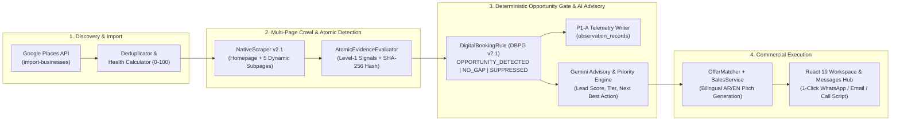

# LeadForge — Evidence-Driven B2B Lead Intelligence & Outreach Engine

[](https://leadforge-ochre.vercel.app)
[](./supabase/functions/_shared/intelligence/opportunity/rules/DigitalBookingRule.ts)
[-059669?style=for-the-badge)](./artifacts/c0_remediated_verdict_report.json)
[-22c55e?style=for-the-badge)](./tests/unit)

**LeadForge** is a full-stack B2B commercial intelligence platform that discovers local service businesses, crawls their live web surfaces (including dynamic booking and contact subpages in English, Arabic, and Dutch), deterministically proves high-value digital infrastructure gaps via atomic HTML/DOM evidence, and generates ready-to-send bilingual (`AR` / `EN`) outreach assets across WhatsApp, Email, Cold Call scripts, and Follow-up sequences.

> **Core Architectural Principle — Zero Hallucinated Opportunities:**
> LLMs are **never** allowed to invent or decide whether a commercial opportunity exists. Commercial opportunities are governed exclusively by deterministic **Level-1 Atomic Evidence Detectors** and **Rule Engines (`DBPG v2.1`)** backed by SHA-256 evidence hashes and append-only telemetry. Gemini is used strictly downstream to synthesize human-readable advisory summaries and tailored sales copy from verified evidence snapshots.

---

## Live Production & Benchmark Highlights

- **Production Web App:** [https://leadforge-ochre.vercel.app](https://leadforge-ochre.vercel.app)
- **98.08% Verified Precision** (`TP = 51`, `FP = 1`, `n = 52` detections; Wilson 95% CI: `[89.88%, 99.66%]`) on a locked 193-site blinded adjudication benchmark (`session-2026-c0`).
- **68.00% Verified Recall** across 100% census adjudication of non-detected businesses (`0.00% UNKNOWN` rate).
- **1-Click Bilingual Outreach (`AR` / `EN`):** Native BiDi/RTL typography (`IBM Plex Sans Arabic` + `Cairo`) with instant `wa.me` deep-linking, cold-call objection matrices, and multi-day follow-up timelines.
- **276 / 276 Automated Tests Passing** across 19 unit, fixture, and `@electric-sql/pglite` database immutability test suites.

---

## System Architecture & 4-Stage Pipeline



### Stage Breakdown

1. **`import-businesses` (Discovery & Hygiene):** Queries Google Places by city and sector, validates coordinates, deduplicates by `place_id` and normalized domain, and computes an initial `0–100` Digital Health Score.
2. **`enrich-business` (Dynamic Subpage Crawl & Signal Extraction):** Fetches the business homepage and dynamically discovers up to **5 internal booking/consultation/contact subpages** across English, Arabic (including URL-encoded slugs), and Dutch (`book`, `appointment`, `schedule`, `consultation`, `contact`, `afspraak`, `حجز`, `موعد`, `استشارة`, `تواصل`). Runs 8 specialized detectors plus the **Level-1 Atomic Evidence Evaluator**.
3. **`analyze-business` (Deterministic DBPG v2.1 Gate + Advisory Synthesis):**
   - Evaluates **`DigitalBookingRule` (`digital_booking_path_gap`)** and **`QuoteIntakeRule`** against verified Level-1 atoms.
   - Persists an immutable `OpportunityEvaluationOutput[]` snapshot (`website_analyses.opportunity_output`) and P1-A telemetry record (`observation_records`).
   - Computes operational priority (`IMMEDIATE`, `HIGH`, `MEDIUM`, `LOW`) and `next_action` (`CALL`, `WHATSAPP`, `EMAIL`, `IGNORE`).
4. **`generate-sales` (Evidence-Bound Outreach Generation):** Matches verified gaps to active `offer_templates` via `OfferMatcher` and generates localized **Arabic (`ar`)** or **English (`en`)** WhatsApp pitches, emails, 10s/30s cold-call hooks with objection handling, and D1/D3/D7 follow-up sequences.

---

## Deep Dive: The `DBPG v2.1` Opportunity Engine

Traditional lead scrapers rely on naive keyword matching—flagging a clinic as "having online booking" merely because a button says *"Book Appointment"* (even when it only links to `tel:` or a generic Name/Email/Message form), or missing real opportunities because a clinic says *"Contact Us"* instead of *"Request Consultation"*.

### Level-1 Atomic Evidence Signals (`AtomicEvidenceEvaluator`)

| Atom | Semantic Definition in `DBPG v2.1` |
|---|---|
| **`CONSULTATION_CTA`** | **Appointment / Consultative Eligibility:** Fires (`PRESENT`) when the site exhibits consultative/appointment CTA intent (`book appointment`, `consultation`, `afspraak maken`, `احجز موعد`, `استشارة`, `تواصل معنا`) or verified appointment-sector clinic identity (`dental`, `orthodont`, `medical clinic`, `tandarts`, `عيادة`, `أسنان`, `مجمع طبي`) paired with an active contact surface. |
| **`APPOINTMENT_CTA`** | **Verified Digital Booking Mechanism:** Fires (`PRESENT`) **strictly** when an actual scheduling mechanism exists: (a) embedded/linked scheduling platforms (`Calendly`, `Fresha`, `HotDoc`, `HealthEngine`, `Cliniko`, `JaneApp`, `Vezeeta`, `Okadoc`, `Doctolib`, `Zocdoc`, `Dental4Windows`, `DentalHub`, `NexHealth`, `LocalMed`, etc.), or (b) interactive scheduling inputs (`<input type="date">`, `<input type="time">`, `datepicker`, `flatpickr`, `wpcf7-date`, calendar/slot widgets). **Negative Guard:** Plain *"Book Appointment"* buttons linking to `tel:`, `wa.me`, or a 3-field contact form never trigger `APPOINTMENT_CTA`. |
| **`DIRECT_CHECKOUT`** | Verified e-commerce cart/checkout flow (`WooCommerce`, `Shopify`, `Stripe Checkout`). Acts as a suppressor so retail stores are never misclassified as booking-gap clinics. |
| **`SELF_SERVICE_PORTAL`** | Authenticated member/patient portal (`client login`, `patient portal`). |
| **`QUOTE_CTA`** | Quote/estimate request intake signal. |
| **`WHATSAPP`** | Verified `wa.me` / `api.whatsapp.com` outreach channel. |

### Blinded Adjudication Benchmark: `DBPG v1` vs. `DBPG v2.1` (Gate 5.13)

To eliminate confirmation bias, `DBPG` was evaluated under a **Blinded Adjudication Protocol (`Gate 5.13-C` / `Gate 5.13-R`)** using a local `@electric-sql/pglite` database (`./artifacts/census_db`) enforced by PostgreSQL immutability triggers (`SQLSTATE 55000` one-way session lock on `review_sessions` and append-only `adjudication_records`):

| Metric | `DBPG v1` (Baseline) | `DBPG v2.1` (Remediated) | Gate 5.13 Threshold | Status |
|---|---|---|---|---|
| **Audited Sample ($N$)** | 193 businesses | 193 businesses | 100% Cohort B Census | **Locked** |
| **Detected Opportunities ($n$)** | 16 (`PROVISIONAL`) | **52 (`STATISTICAL_VALIDATION`)** | $n \ge 50$ | **PASS** |
| **True Positives (`TP`)** | 5 | **51** (+920%) | — | — |
| **False Positives (`FP`)** | 11 | **1** (-91%) | — | — |
| **Precision** | `31.25%` | **`98.08%`** | $\ge 70.0\%$ | **PASS** |
| **Wilson 95% CI (Precision)** | `[14.16%, 55.60%]` | **`[89.88%, 99.66%]`** | Lower Bound $\ge 50.0\%$ | **PASS** |
| **Recall** | `6.67%` | **`68.00%`** | $\ge 60.0\%$ | **PASS** |
| **FP Rollback Rate** | `68.75%` | **`1.92%`** | $\le 30.0\%$ | **PASS** |
| **UNKNOWN Rate** | `0.00%` | **`0.00%`** | $\le 25.0\%$ | **PASS** |
| **Official Gate Verdict** | `PROVISIONAL_FAIL` | **`STATISTICAL_PASS`** | All 6 Criteria Met | **PASS** |

---

## Frontend UX & Sales Execution Features

- **Command Center (`DashboardPage`):** Real-time operational breakdown (Call Now, Send Audit, Follow Up, Blocked), opportunity distribution tiles, and responsive skeleton loading states.
- **Pipeline & Business Table (`PipelinePage`, `BusinessTable`):**
  - 1-click **"Booking Gap (DBPG)"** filter (`?view=booking_gap`) surfacing verified `OPPORTUNITY_DETECTED` leads immediately.
  - Inline **"Copy WA"** and **"Send WA"** (`wa.me` deep link with pre-filled Arabic/English pitch) directly on every card and table row—reducing outreach execution from 6 clicks to **1 click**.
- **360° Lead Workspace (`LeadWorkspacePage`):**
  - **Decision Header:** Displays Lead Score, Priority Tier, `DBPG v2.1` status badge, and `Verification Strength`.
  - **Atomic Signals Strip (`OpportunityMatrix`):** Visualizes all 6 Level-1 atoms (`PRESENT` / `ABSENT`) alongside the human-readable `audit_trail`.
  - **Real-Time Telemetry (`DeveloperMode`):** Inspects live rule slugs, engine versions, evidence signal counts, and raw JSON payloads.
- **Multi-Channel Messages Hub (`MessagesPage`):** Dedicated channel views for **WhatsApp**, **Email** (`mailto:` + copy subject/body), **Cold Call Scripts** (10s Hook, 30s Pitch, Objection Handling), and **Follow-Up Sequences** (D1, D3, D7 timeline).
- **First-Class Arabic RTL / BiDi Support:** Automatic script detection (`hasArabicCharacters` + `dir="auto"`), `IBM Plex Sans Arabic` & `Cairo` typography, and runtime `AR` / `EN` regeneration inside `SalesAssetsModal`.

---

## Tech Stack

| Layer | Technologies |
|---|---|
| **Frontend** | React 19, TypeScript 6, Vite 8, Tailwind CSS v4, TanStack Query v5, React Router v7, Radix UI, Lucide Icons |
| **Backend & Edge Runtime** | Supabase (PostgreSQL 15 + Row-Level Security), 11 Deno Edge Functions (`supabase/functions/`) |
| **Intelligence & AI** | Deterministic Rule Engine (`DBPG v2.1`), `@google/genai` (Gemini 2.5 Flash), Google Places API |
| **Audit & Testing** | Vitest 5 (`276` tests across `19` suites), `@electric-sql/pglite` (hermetic SQL & immutability testing), Playwright |
| **Hosting & CI/CD** | Vercel (Frontend Production), Supabase Cloud (Database & Edge Functions) |

---

## Repository Structure

```text
LeadForge/
├── src/
│   ├── components/layout/          # Sidebar (with Saved Views & DBPG filter), Topbar, AppLayout
│   ├── features/
│   │   ├── dashboard/
│   │   │   ├── components/         # BusinessTable, PipelineView, workspace/ (DecisionHeader,
│   │   │   │                       # OpportunityMatrix, SalesAssetsModal, AnalysisDetailsModal, DeveloperMode)
│   │   │   ├── hooks/              # TanStack Query hooks for businesses, analysis, sales generation
│   │   │   ├── services/           # Typed API client wrappers for Supabase Edge Functions
│   │   │   └── utils/dbpg-Shared.ts# Universal DBPG v2.1 evidence extractor & BiDi helper
│   │   ├── intelligence/           # Next Best Action scoring hook
│   │   ├── projects/               # Multi-tenant project management
│   │   └── search/                 # Google Places import sessions & search form
│   └── pages/                      # Dashboard, Pipeline, LeadWorkspace, Messages, DataInspector, Auth
├── supabase/
│   ├── functions/
│   │   ├── _shared/
│   │   │   ├── detection/          # AtomicEvidenceEvaluator, CtaContextDetector, TransactionDetector, SelfServiceDetector
│   │   │   ├── intelligence/       # DigitalBookingRule (DBPG v2.1), QuoteIntakeRule, Evidence Engine
│   │   │   ├── scraper/            # NativeScraper v2.1 (dynamic multilingual subpage discovery)
│   │   │   ├── telemetry/          # P1-A ObservationWriter & canonical SHA-256 evidence hashing
│   │   │   ├── ai/                 # GeminiService, PromptBuilder, Consultant v2 & Sales Generator prompts
│   │   │   └── repositories/       # Typed data access layer (analysis, business, capability, sales)
│   │   ├── import-businesses/      # Stage 1 Edge Function
│   │   ├── enrich-business/        # Stage 2 Edge Function
│   │   ├── analyze-business/       # Stage 3 Edge Function
│   │   ├── generate-sales/         # Stage 4 Edge Function
│   │   └── businesses/             # Project lead list & relational hydrated query
│   └── migrations/                 # Consolidated schema, Gate 5.12.3 opportunity_output, P1-A telemetry, schema alignment
├── scripts/audit/                  # Zero-LLM C0 census runner, blinded CSV tooling, independent site inspector, v2.1 replay
├── artifacts/                      # Locked C0 run summary, blinded review CSV, v1 & v2.1 official JSON verdict reports
└── tests/unit/                     # 19 test suites (detectors, rules, PGlite immutability triggers, UI helpers)
```

---

## Local Development & Verification

### 1. Prerequisites & Installation
```bash
npm install
cp .env.example .env.local
```

Configure `.env.local` with your Supabase project credentials:
```env
VITE_SUPABASE_URL=https://your-project-ref.supabase.co
VITE_SUPABASE_ANON_KEY=your-anon-key
```

### 2. Run Development Server
```bash
npm run dev
```

### 3. Run the Full Test Suite & Production Build
```bash
# Run all 19 test suites (276 unit, fixture, and PGlite SQL tests)
npm test

# Type-check with TypeScript 6 and build production bundle
npm run build
```

### 4. Reproduce the Gate 5.13 `DBPG v2.1` Diagnostic Replay
```bash
npx tsx scripts/audit/replay-c0-diagnostic.ts
```

---

## License

Private & Proprietary — Engineered by **Amgad Ghozzy**.
