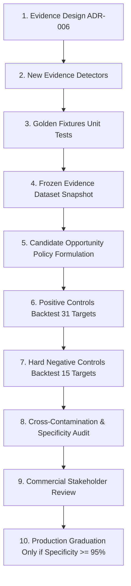

# ADR-006: Opportunity Evidence Design & Commercial Grounding Contract

**Status:** PROPOSED / UNDER REVIEW 🔍  
**Date:** 2026-09-22  
**Parent Decision:** [`ADR-005 Section 10.3`](file:///D:/MyProjects/LeadForge/docs/contracts/ADR-005-opportunity-engine-freeze.md#103-hard-negative-controls-audit-results-hard_negative_control_spec-v1)  
**Scope:** `_shared/intelligence/evidence/types.ts`, `_shared/intelligence/evidence/*`, `_shared/intelligence/opportunities/*`  

---

## 1. Executive Summary & Context

Following the formal execution of [`HARD_NEGATIVE_CONTROL_SPEC v1`](file:///D:/MyProjects/LeadForge/docs/contracts/HARD_NEGATIVE_CONTROL_SPEC_v1.md) against 15 real-world service businesses, all surface-level heuristic rules (**Patterns A, C, and E**) were conclusively broken:
- **Pattern A (`PHONE ∧ ¬BOOKING ∧ ¬CHATBOT`):** Specificity = 63.64% (FP Rate = 36.36%).
- **Pattern C (`WHATSAPP ∧ ¬BOOKING`):** Specificity = 72.73% (FP Rate = 27.27%).
- **Pattern E (`PHONE ∧ EMAIL ∧ ¬BOOKING ∧ ¬CHATBOT`):** Specificity = 72.73% (FP Rate = 27.27%).
- **Combined `ANY(A, C, E)`:** Specificity = 54.55% (**FP Rate = 45.45%**).

This empirical failure demonstrated that surface-level contact heuristics (`has_phone`, `has_email`, `has_whatsapp`) cannot distinguish between:
1. An unoptimized service business that genuinely loses leads and needs automated nurturing.
2. An automated digital platform, self-service subscription service, emergency dispatch provider, or regulated institution where contact details are merely regulatory disclosures or customer support channels.

**ADR-006 establishes the foundational Evidence Design Contract required before any new Detectors are coded or any Opportunity Rules are considered for production.**

---

## 2. Section 1: Lessons from A/C/E Failure

### 1.1 The Channel-to-Commercial Leap Fallacy
The fatal flaw of Patterns A, C, and E was attempting to leap directly from channel-level observable existence to a commercial operations conclusion:

$$\text{Channel Detection} \not\longrightarrow \text{Operational Opportunity}$$

```
FLAWED APPROACH (Patterns A, C, E):
[Phone / Email / WhatsApp detected] ──> [Assert: Lead Nurturing Opportunity exists] ❌

GROUNDED ARCHITECTURE (ADR-006):
[Website Evidence] ──> [Business Model & Intent] ──> [Customer Journey Stage] ──> [Operational Opportunity] ✅
```

### 1.2 Forensic Failure Modes from Hard Negatives
The forensic audit exposed four distinct failure mechanisms in real commercial service businesses:

1. **Regulatory Disclosures vs. Commercial Intake (`Lendo - hn-006`):**
   - *Observation:* Visible phone and email; no booking or chatbot.
   - *Reality:* 100% digital crowdlending platform under SAMA regulatory sandbox. Phone and email are legal/regulatory compliance disclosures for consumers, not pipeline entry points for outbound sales nurturing.
2. **Emergency Dispatch vs. Nurture Sequences (`Morni - hn-007`):**
   - *Observation:* Visible phone and WhatsApp; no booking or chatbot.
   - *Reality:* On-demand roadside assistance and emergency towing dispatched via mobile app. Emergency needs demand immediate response; delayed email/WhatsApp nurture sequences are commercially absurd.
3. **WhatsApp as Support vs. Acquisition (`PureGym - hn-014` & `Morni - hn-007`):**
   - *Core Finding:* $\text{WhatsApp} \neq \text{Lead Nurturing}$.
   - WhatsApp is frequently deployed for post-sale support, account troubleshooting, physical club inquiries, or operational dispatch, rather than inbound lead qualification.
4. **Standardized Self-Service Subscriptions (`Fitness First - hn-015` & `Hive - hn-016`):**
   - *Observation:* Visible contact info; absence of calendar booking.
   - *Reality:* Memberships and hot desks are purchased directly through self-service digital checkouts. No sales nurturing is required or offered.

### 1.3 The "Absence of Website Feature" Fallacy
Heuristic rules assumed that `BOOKING=ABSENT` proved an operational gap. The audit proved that `ABSENCE OF FEATURE` is inherently ambiguous:
$$\text{NO\_BOOKING observed on website} \Longrightarrow \begin{cases} 
\text{Booking handled via mobile app} \\
\text{Booking handled via direct phone call} \\
\text{Booking handled inside private CRM/portal} \\
\text{Business model does not require booking} \\
\text{Genuine operational gap (only a fraction of cases)}
\end{cases}$$

> [!CRITICAL]
> **Absence of a website feature can NEVER, on its own, serve as sufficient evidence for an operational opportunity.** Opportunity detection requires positive confirmation of business model fit combined with affirmative interaction requirements.

---

## 3. Section 2: Candidate Evidence Taxonomy

To ground opportunities in verifiable facts, ADR-006 defines five orthogonal categories of website evidence.

### 2.1 Taxonomy Evaluation Matrix

| Evidence Identifier | Category | Strictly Observable? | Deterministic? | Commercial Relevance | Inference Risk | Role in Policy |
| :--- | :--- | :---: | :---: | :---: | :---: | :--- |
| `DIRECT_CHECKOUT` | Transaction Model | Yes | High | **High** | Low | Negative Evidence (Suppressor) |
| `QUOTE_REQUEST` | Transaction Model | Yes | High | **High** | Low | Positive Opportunity Gate |
| `CONSULTATION_REQUIRED` | Transaction Model | Yes | High | **High** | Medium | Positive Opportunity Gate |
| `APPOINTMENT_REQUIRED` | Transaction Model | Yes | High | **High** | Low | Positive Opportunity Gate |
| `APPLICATION_REQUIRED` | Transaction Model | Yes | High | **High** | Low | Positive Opportunity Gate |
| `ACQUISITION_CTA` | Conversion Mechanism | Yes | Medium | **High** | Medium | Pipeline Intent Confirmation |
| `SUPPORT_CTA` | Conversion Mechanism | Yes | Medium | **High** | Low | Negative Evidence (Suppressor) |
| `SELF_SERVICE_PORTAL` | Capability | Yes | High | **High** | Low | Negative Evidence (Suppressor) |
| `APP_BASED_SERVICE` | Capability | Yes | High | **High** | Low | Negative Evidence (Suppressor) |
| `MEMBERSHIP_SUBSCRIPTION`| Capability | Yes | High | **High** | Low | Negative Evidence (Suppressor) |
| `MULTI_STAGE_JOURNEY` | Journey Complexity | Yes | Medium | **High** | Medium | High-Value Pipeline Indicator |
| `INTERNAL_CRM` | External / Private | **No** | — | High | **Prohibited** | Out-of-Scope (Unobservable) |
| `LEAD_VOLUME` | Private Metric | **No** | — | High | **Prohibited** | Out-of-Scope (Unobservable) |
| `RESPONSE_SPEED` | Private Metric | **No** | — | High | **Prohibited** | Out-of-Scope (Unobservable) |

---

### 2.2 Detailed Category Specifications

#### Category 1: Transaction Model (`tx_model`)
Determines how the business fundamentally exchanges value with its customers:
- **`DIRECT_CHECKOUT`**: E-commerce cart, Stripe/Checkout gateway, instantaneous online card payment for services.
- **`QUOTE_REQUEST`**: Explicit "Request a Quote", "Get Pricing", "Submit RFQ", "Request Proposal" forms.
- **`CONSULTATION_REQUIRED`**: "Schedule Consultation", "Speak with an Expert", "Free Assessment".
- **`APPOINTMENT_REQUIRED`**: "Book Appointment", "Schedule Meeting", "Book a Slot".
- **`APPLICATION_REQUIRED`**: "Apply Now", "Submit Application", multi-step vetting before service engagement.
- **`UNKNOWN`**: Insufficient DOM evidence to classify transaction flow.

#### Category 2: Conversion Mechanism (`conversion_intent`)
Distinguishes between **Acquisition CTAs** and **Support/Retention CTAs**:
- **`ACQUISITION_CTA`**: CTAs designed to attract new prospects ("Start Your Project", "Book Demo", "Inquire Now", "Become a Client").
- **`SUPPORT_CTA`**: CTAs designed for existing customers ("Help Desk", "Submit Ticket", "Support Hotline", "Track Order", "Customer Portal").
- *Architectural Rule:* A contact signal (phone/WhatsApp/email) accompanied exclusively by `SUPPORT_CTA` context must NEVER be treated as a lead-capture mechanism.

#### Category 3: Service Interaction Requirement (`interaction_req`)
Determines whether service delivery inherently requires personalized scoping before sale:
- **`B2B_CUSTOM_SERVICE`**: Commercial terms, pricing, or deliverables vary per client.
- **`STANDARDIZED_COMMODITY`**: Flat pricing, off-the-shelf packages, fixed rates.

#### Category 4: Self-Service Capability (Negative Evidence / Suppressors)
Provides affirmative evidence that the business is automated and does NOT require lead nurturing:
- **`ONLINE_CHECKOUT = PRESENT`**
- **`SELF_SERVICE_PORTAL = PRESENT`**
- **`ONLINE_MEMBERSHIP = PRESENT`**
- **`APP_BASED_SERVICE = PRESENT`** (e.g. App Store / Google Play download buttons dominating the above-the-fold CTA)

#### Category 5: Customer Journey Complexity (`journey_complexity`)
Observed multi-step sales processes declared explicitly on website pages:
$$\text{LEAD} \longrightarrow \text{QUALIFICATION FORM} \longrightarrow \text{CONSULTATION} \longrightarrow \text{QUOTE} \longrightarrow \text{CONTRACT}$$

---

## 4. Section 3: Observable vs. Inferred Boundaries (The Golden Rule)

> [!IMPORTANT]
> ### 🛡️ THE GOLDEN RULE OF LEADFORGE EVIDENCE
> **"إذا احتاجت الـ Evidence إلى معرفة ما يحدث داخل الشركة، فهي ليست Website Evidence."**  
> *(If an Evidence signal requires knowing what happens inside the company, it is NOT Website Evidence.)*

### Prohibited Inferences vs. Valid Observable Facts

```text
┌────────────────────────────────────────────────────────────────────────────┐
│ STRICTLY PROHIBITED INFERENCES (Violates Architectural Boundaries)         │
├────────────────────────────────────────────────────────────────────────────┤
│ ❌ Guessing whether the company uses Salesforce, HubSpot, or a spreadsheet │
│ ❌ Estimating the company's daily inbound lead volume                      │
│ ❌ Inferring how quickly their sales team replies to inquiries             │
│ ❌ Assuming that lack of a calendar link means no bookings occur           │
│ ❌ Assuming phone visibility means a sales rep is answering calls          │
└────────────────────────────────────────────────────────────────────────────┘

┌────────────────────────────────────────────────────────────────────────────┐
│ STRICTLY VALID OBSERVABLE EVIDENCE (Ground Truth from Scrape Artifacts)    │
├────────────────────────────────────────────────────────────────────────────┤
│ ✅ DOM element containing a form with fields: [Name, Budget, Project Scope]│
│ ✅ Text anchor with explicit string: "Request a custom quotation"          │
│ ✅ Links pointing to app.apple.com / play.google.com                       │
│ ✅ E-commerce checkout scripts (Shopify, WooCommerce, Stripe Elements)     │
│ ✅ Presence of a customer login / authentication portal link               │
└────────────────────────────────────────────────────────────────────────────┘
```

---

## 5. Section 4: Tri-State Semantics & Polarity Contract

In accordance with [`ADR-004`](file:///D:/MyProjects/LeadForge/docs/contracts/ADR-004-evidence-layer-freeze.md), every Evidence item strictly follows **Tri-State Semantics**:

$$\text{EvidencePolarity} \in \{\text{PRESENT}, \text{ABSENT}, \text{UNKNOWN}\}$$

### Polarity Assignment Rules
1. **`PRESENT`**:
   - Definitively observed with deterministic DOM/text evidence exceeding confidence thresholds.
2. **`ABSENT`**:
   - The relevant website scope was successfully crawled and scraped, and the signal was affirmatively not found.
   - *Requirement:* Requires high observability ($\ge 3$ crawlable pages including Home, Contact/About, and Pricing/Services).
3. **`UNKNOWN`**:
   - Crawl failed, was rate-limited (HTTP 429/546), blocked by Cloudflare/WAF, or insufficient pages were observable.
   - *Strict Rule:* An `UNKNOWN` signal cannot satisfy a positive rule condition, nor can it serve as an absent suppressor.

### Negative Evidence (Suppressor) Semantics
If any **Suppressor Evidence** is evaluated as `PRESENT`, all dependent Lead Nurturing Opportunity candidates are immediately invalidated:
$$\text{Suppressor} \in \{\text{DIRECT\_CHECKOUT}, \text{APP\_BASED\_SERVICE}, \text{SELF\_SERVICE\_PORTAL}\} = \text{PRESENT} \implies \text{OpportunityCandidate} = \text{NOT\_FIT}$$

---

## 6. Section 5: Candidate Evidence Combinations (Pre-Rule Hypotheses)

The following combinations illustrate how richer evidence types will interact. **These are analytical hypotheses for future testing, NOT active rules.**

### Hypothesis H-1: High-Ticket Custom Service Opportunity
$$\begin{aligned}
\text{Candidate Fit} \iff &(\text{QUOTE\_REQUEST} = \text{PRESENT} \lor \text{CONSULTATION\_REQUIRED} = \text{PRESENT}) \\
&\land (\text{DIRECT\_CHECKOUT} = \text{ABSENT}) \\
&\land (\text{APP\_BASED\_SERVICE} = \text{ABSENT}) \\
&\land (\text{CUSTOMER\_ACQUISITION\_CTA} = \text{PRESENT}) \\
&\land (\text{AUTOMATED\_QUALIFICATION\_FORM} = \text{ABSENT})
\end{aligned}$$

### Hypothesis H-2: Regulatory / Self-Service Disqualification (Negative Guard)
$$\begin{aligned}
\text{Disqualified} \iff &(\text{APP\_BASED\_SERVICE} = \text{PRESENT}) \\
&\lor (\text{DIRECT\_CHECKOUT} = \text{PRESENT}) \\
&\lor (\text{SELF\_SERVICE\_PORTAL} = \text{PRESENT}) \\
&\lor (\text{SUPPORT\_ONLY\_CONTACT} = \text{PRESENT})
\end{aligned}$$

---

## 7. Section 6: Governance & The Rigorous 10-Step Lifecycle

No code may be written in `_shared/intelligence/opportunities/rules.ts` until the following 10-step validation pipeline is executed:



### Current Status of the Engine:
```typescript
// LeadForge Opportunity Engine Status
export const OPPORTUNITY_RULES: OpportunityRule[] = []; // ZERO_RULES 🔒
```

- **Production Rules:** `0` (Engine remains completely frozen).
- **Scope of Next Phase:** Design and unit-test candidate **Evidence Detectors** against local Golden Fixtures only. Zero production mutations, zero schema changes, zero premature rule activation.

---

## 8. Summary of Revisions & Approvals

| Version | Date | Changes | Author / Reviewer |
| :--- | :--- | :--- | :--- |
| `0.1.0-draft` | 2026-09-22 | Initial Evidence Design Contract based on Hard Negative findings | Antigravity / Engineering Review |
